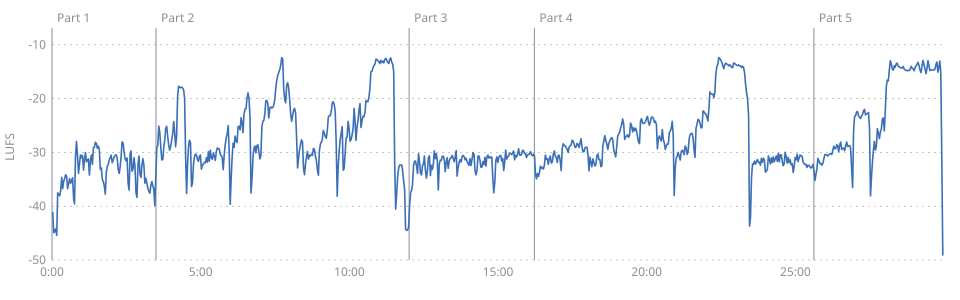

# Night Music for Orchestra

*Night Music for Orchestra* is a new work for large orchestra: one movement in five linked parts, 30 minutes.
Code makes all parts of the work: the score, the parts, the audio, and the score video.

The work takes its style from three sources:

- Arnold Schoenberg, and primarily *Verklärte Nacht*.
- Béla Bartók, and primarily his "night music" style.
- John Corigliano.

The work also uses ideas from the music of different regions of the world.

## Results

Each build of the repository publishes the results in the release
[`latest`](https://github.com/collide2954/night-music-for-orchestra/releases/tag/latest).

| File | Contents |
| --- | --- |
| `night-music-score.pdf` | The conductor score, in C |
| `night-music-parts.zip` | The parts of all players (PDF files) |
| `night-music.flac` | The audio master (24 bit, 48 kHz) |
| `night-music.mp3` | The audio master (MP3) |
| `night-music.mp4` | The score video: the score, a cursor, and a ribbon that shows which instruments play |

## The work

| Part | Bars | Start | Contents |
| --- | --- | --- | --- |
| 1 | 1 to 38 | 0:00 | Very slow. A walk in the dark. One lonely melody. |
| 2 | 39 to 220 | 3:29 | Agitation and development. A chase in uneven metres. The first climax, then a collapse. |
| 3 | 221 to 262 | 12:00 | The still centre. A soft cluster, a cycle of gongs, calls of the night. |
| 4 | 263 to 398 | 16:13 | The turn to D major. Broad warm themes. A shimmer of bells. The main climax, then calm. |
| 5 | 399 to 457 | 25:37 | First light. The themes sound together. The last statement, fff. |

The picture shows the loudness of the audio master against the time.
The two climaxes are at 11 minutes and at 22 minutes. The last statement starts at 28 minutes.



One idea of three notes (the motto) is in all parts.
It starts as D, E-flat, A-flat (dark) and ends as D, E, A (light).
The document [`docs/work.md`](docs/work.md) gives the full form, the themes, and the sources of the ideas.

The orchestra has 97 players: triple and quadruple woodwinds, six horns, a large percussion
section, harp, celesta, piano, and strings.
It also has four instruments that are not usual in an orchestra: cimbalom, accordion, mandolin, and ocarinas.

## Project status

| Stage | Result | Status |
| --- | --- | --- |
| 1. Style study | Tables of measured and sourced style parameters | First edition complete |
| 2. Design | Form, orchestra, and material of the work | Complete |
| 3. Composition | The music, written as code | First version complete (457 bars) |
| 4. Engraving | Conductor score and parts | Complete. See "Limits". |
| 5. Audio | Audio from free sample libraries | Complete. See "Limits". |
| 6. Video | Score video with part tracking | Complete |

## How the project makes the results

```text
src/nightmusic/work      the music, as Python code (one file for each part)
        |
        v
src/nightmusic/notation  LilyPond files  ->  score PDF, part PDFs, pages for the video
src/nightmusic/perform   a list of notes with loudness, length, and playing technique
        |
        v
src/nightmusic/audio     samples -> stage and hall -> master (FLAC, MP3)
src/nightmusic/video     pages + cursor + ribbon -> MP4
```

- The music is text in a subset of the LilyPond language. The code reads it one time and uses it for all results.
- The audio uses free sample libraries. A model of a stage with a main pair of microphones gives the stereo image. A model of a concert hall gives the reverberation.
- The master has three steps: equalization, gain riding, and level. The targets are measured values of real orchestra recordings (see [`research/measured/reference_recordings.csv`](research/measured/reference_recordings.csv)).

## Style study

The style study is in the [`research`](research/README.md) directory.
The full report is [`docs/style-study.md`](docs/style-study.md).

The study measured the complete *Verklärte Nacht* (418 bars) and two sets of piano works by Bartók.
It also contains sourced tables for form, harmony, rhythm, orchestration, and orchestra sizes.
The style profiles in the report give the target ranges for the new work.

## Design

The directory [`design`](design) contains the decisions and the plan of the work.

| File | Contents |
| --- | --- |
| [`brief.toml`](design/brief.toml) | The decisions of the owner of the project |
| [`form.toml`](design/form.toml) | The five parts, the positions of the main events, and the targets |
| [`pitch.toml`](design/pitch.toml) | The motto, its four states, the key centres, and the processes |
| [`orchestra.toml`](design/orchestra.toml) | The players, the instruments, and their ranges |

## Requirements

- [uv](https://docs.astral.sh/uv/) 0.5 or later
- GNU Make
- For the score and the parts: [LilyPond](https://lilypond.org/) 2.26 or later
- For the audio: [FFmpeg](https://ffmpeg.org/), Git, and 6 GB of disk space for the sample libraries
- For the video: FFmpeg with the `libopenh264` encoder, and Poppler (`pdftoppm`)

## How to build

1. Install the Python environment:

   ```bash
   uv sync
   ```

2. Make sure that the music has no notes out of range:

   ```bash
   uv run nightmusic check
   ```

3. Build the score and the parts:

   ```bash
   uv run nightmusic parts
   ```

4. Build the audio. The first build downloads the sample libraries and measures them.

   ```bash
   uv run nightmusic audio
   ```

5. Build the video. The audio must be there before you build the video.

   ```bash
   uv run nightmusic video
   ```

The results are in the directory `build`.

To hear only some bars, give the first bar and the last bar:

```bash
uv run nightmusic audio --bars 207-220
```

To measure the work (dynamic levels and tempo marks):

```bash
uv run nightmusic stats
```

To draw the picture of the loudness (the audio must be there):

```bash
uv run nightmusic chart
```

To build the style study:

```bash
make study
```

## Limits

- The audio comes from free sample libraries. It is not a recording of an orchestra.
- Some instruments use the samples of a similar instrument:
  the accordion (chromatic harmonica), the cimbalom (Hungarian zither),
  the contrabass clarinet (bass clarinet), the clarinet in E-flat (clarinet in B-flat),
  and the tuned gongs (tubular bells).
- The audio does not play trills as trills.
- The parts do not have cue notes.
- No orchestra has played the work. A conductor and the players must examine the parts before a performance.

## Licence

- The code is under the MIT License. See [`LICENSE`](LICENSE).
- The music, the score, the parts, the audio, the video, and the documents are under the
  Creative Commons Attribution 4.0 International licence (CC BY 4.0).
  See [`LICENSE-CC-BY-4.0`](LICENSE-CC-BY-4.0).
- The style study measures open data from other authors. These data have their own licences.
  See [`research/README.md`](research/README.md).
- The sample libraries have their own licences. See [`src/nightmusic/audio/library.py`](src/nightmusic/audio/library.py).
